# Solar System Voyager

**日本語** | [English](README.en.md)

太陽・惑星・主要衛星・準惑星・小惑星・彗星・探査機を **実寸・実距離** で配置した 3D 宇宙飛行シミュレータです。
天体の位置は PC の時刻 (UTC) から計算し、等倍ではリアルタイムに公転・自転します。

- 描画エンジン: [raylib 5.5](https://www.raylib.com/)（OpenGL 3.3）
- 対応: Linux (gcc) / Windows (MinGW-w64)

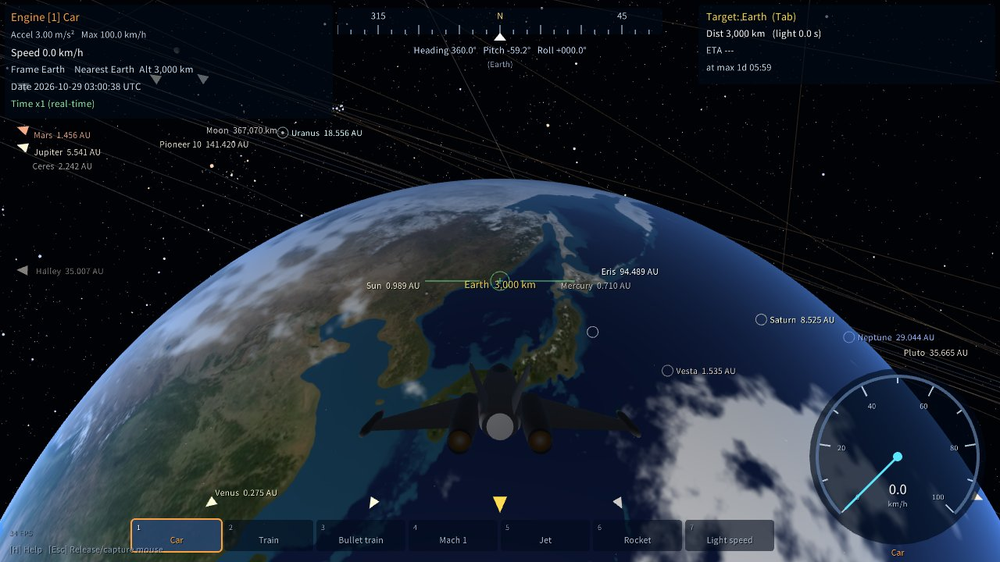

| | |
|---|---|
| 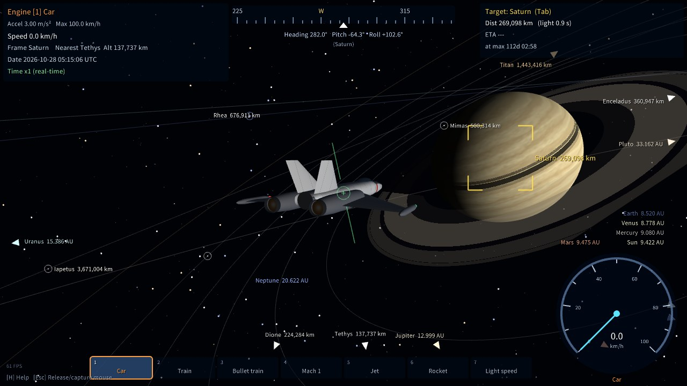 土星と環（本体に落ちる環の影） | 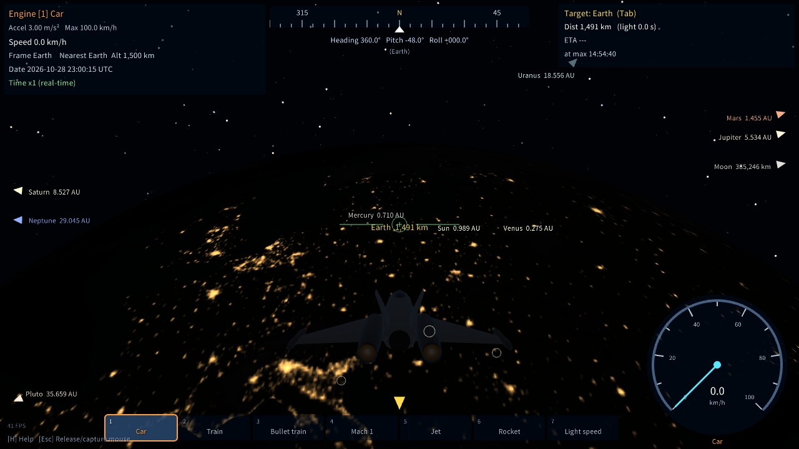 夜のヨーロッパの街明かり |
| 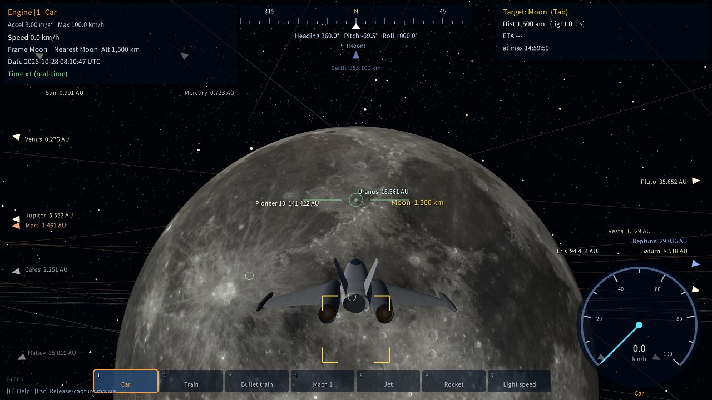 月の表側（NASA の実データ） | 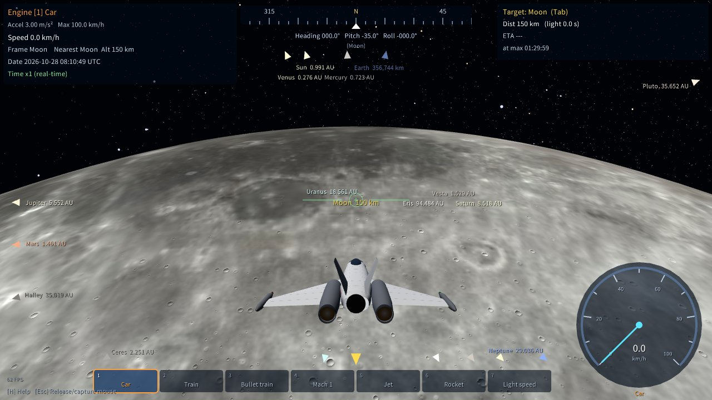 ティコ付近の低空飛行 |
| 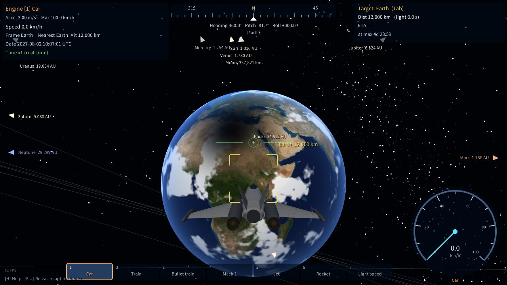 2027年8月2日の日食（月の影が北アフリカに落ちる） | 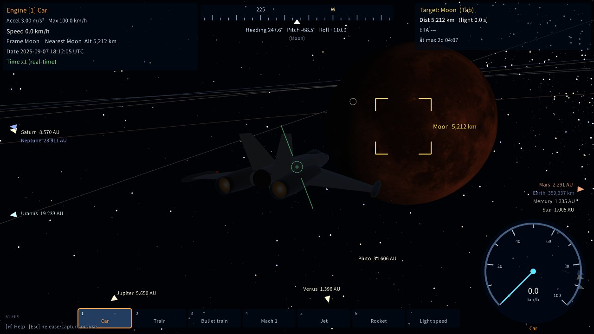 2025年9月7日の皆既月食 |
| 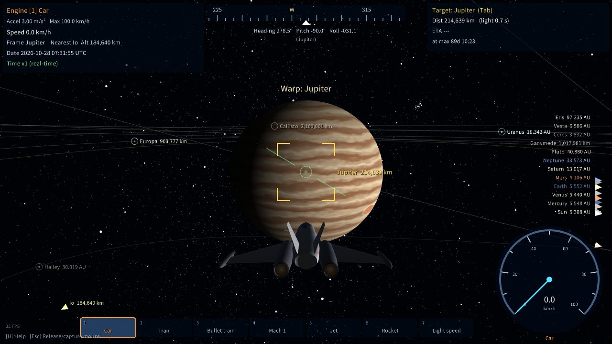 木星 | 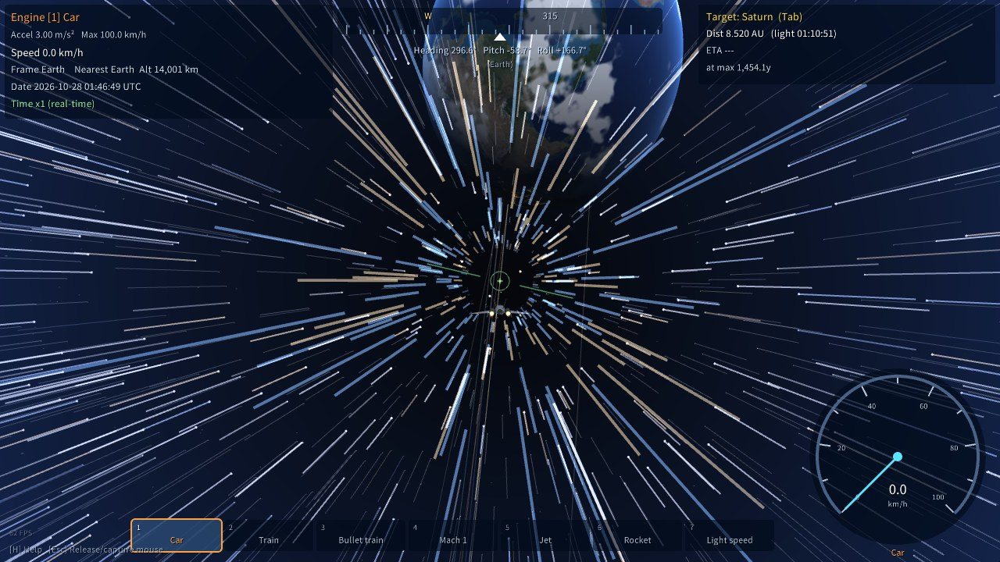 ワープ演出 |
| 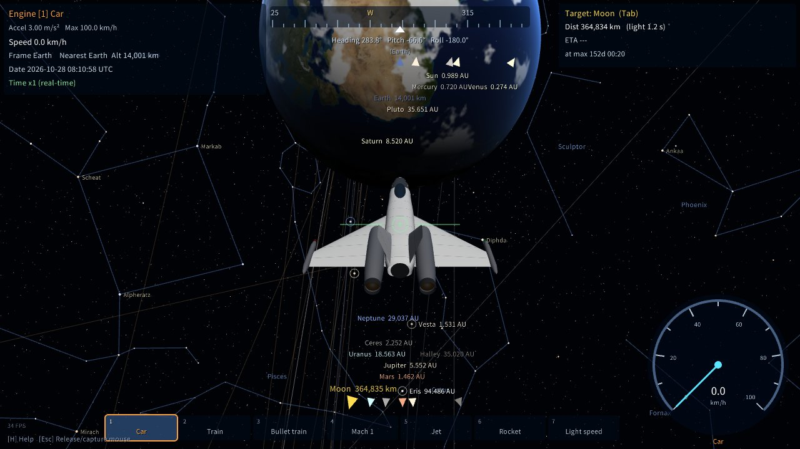 実在の星空と星座線（C キー） | 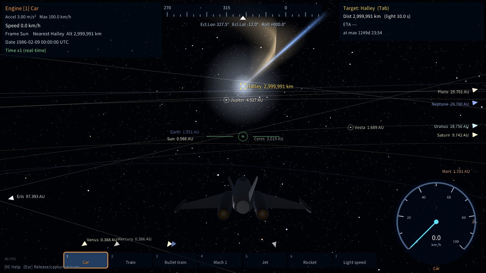 1986年2月9日（近日点）のハレー彗星 |
| 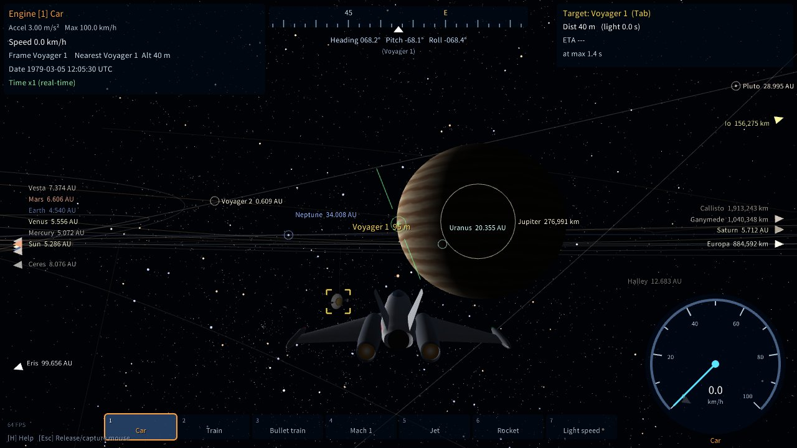 1979年3月5日、木星に最接近するボイジャー1号（K キー → Tab） | 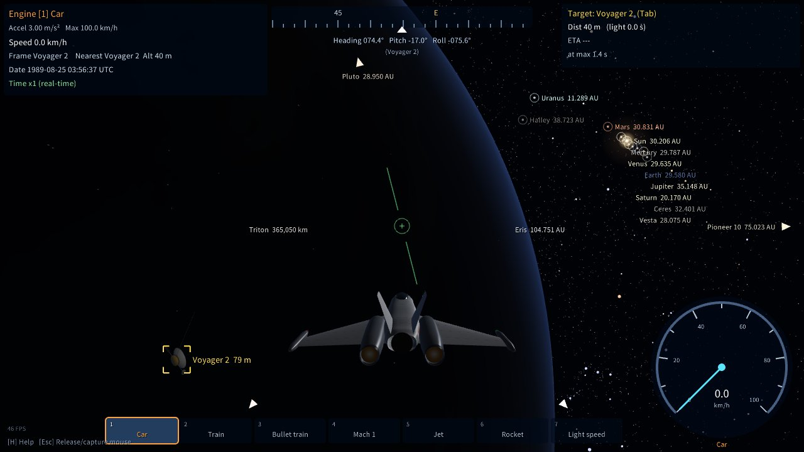 1989年8月25日、海王星の夜側を通過するボイジャー2号 |

## ビルド

CMake が raylib 5.5 のソースを自動取得して静的リンクします（初回のみネット接続が必要）。

### Linux

```sh
# Debian/Ubuntu の依存パッケージ
sudo apt install build-essential cmake libx11-dev libxrandr-dev libxinerama-dev libxcursor-dev libxi-dev libgl1-mesa-dev
cmake -B build -DCMAKE_BUILD_TYPE=Release
cmake --build build -j
./build/solar_voyager
```

### Windows (MSYS2 MinGW64)

```sh
pacman -S mingw-w64-x86_64-gcc mingw-w64-x86_64-cmake mingw-w64-x86_64-ninja
cmake -B build -G Ninja -DCMAKE_BUILD_TYPE=Release
cmake --build build
./build/solar_voyager.exe
```

DLL 不要の単体 exe になります。コンソールを出したい場合は `-DSOLAR_CONSOLE=ON`。

### Linux から Windows 版をクロスビルド

```sh
cmake -B build-win -DCMAKE_TOOLCHAIN_FILE=cmake/mingw-w64-x86_64.cmake -DCMAKE_BUILD_TYPE=Release
cmake --build build-win -j
```

## パッケージ作成

ビルド後、ビルドフォルダで `cpack` を実行します。

| 対象 | コマンド | 出力 |
|---|---|---|
| Windows (7-Zip) | `cd build-win && cpack` | `SolarSystemVoyager-<版>-win64.7z`（展開してそのまま使えるポータブル版） |
| Linux (.deb / .rpm) | `cd build && cpack` | `solar-voyager_<版>_amd64.deb` / `solar-voyager-<版>-1.x86_64.rpm` |

- Linux 版は `/usr/bin/solar_voyager` に入り、アプリメニュー（ゲーム）にアイコン付きで登録されます。`.rpm` の作成には `rpmbuild` が必要です
- 片方だけ作る場合: `cpack -G DEB` / `cpack -G RPM`
- バージョンは `CMakeLists.txt` の `project(... VERSION ...)`、`.deb` の Maintainer 欄は `-DSOLAR_PACKAGE_CONTACT="名前 <メール>"` で指定します
- exe のファイルアイコンとウィンドウのアイコンは `assets/icon.ico` / `assets/icon.png` です（`python3 tools/make_icon.py` で生成、Pillow が必要）

## 操作

| キー | 動作 |
|---|---|
| マウス / 矢印キー | 機首の上下・左右 |
| A / D | ヨー、Q / E : ロール |
| W | 加速（離しても速度を維持） |
| S | 減速・後退 |
| X | 停止 |
| 1〜7 / ホイール | エンジン切替 |
| Tab / Shift+Tab | ターゲット切替 |
| F | ターゲットへ機首を向ける |
| G / Shift+G | ターゲットへワープ / 地表付近へワープ（約 1.7 秒のワープ演出付き。演出中は操縦不可） |
| T / Shift+T | 自動操縦 / 自動操縦（エンジン自動選択） |
| 右クリック（押下中） | ズーム |
| V | 追尾視点 / コクピット視点 |
| O / L | 軌道表示 / 衛星マーカー |
| C | 星座の表示（なし → 星座線 → 星座線と名前） |
| [ / ] | 時間倍率（x1 実時間 〜 1年/秒）。天体の公転・自転と自機の加速・移動の両方に効く |
| P / Backspace | 時間停止 / 現在時刻・等倍に同期 |
| Y | 日時を指定（UTC。数字を入力して Enter） |
| K | イベント一覧（選んで Enter でその日時・場所へワープ）。Tab / Shift+Tab でページを切り替え: 天文イベント（今後 3 年の日食・月食・惑星どうしの接近・衝、木星面を衛星の影が通過する次の時刻、150 年先までの水星・金星の太陽面通過）、彗星（近日点・地球への最接近）、探査機のできごと（惑星への最接近・周回開始・運用終了） |
| I | マウス上下反転 |
| J | 言語切替（日本語 / English） |
| B / N | 現在地をブックマーク / ブックマークへ順にワープ（最大 9 か所。天体と一緒に回る位置・向きを保存） |
| M / Shift+M | 効果音（エンジン音・ワープ音）/ 音楽 のオン・オフ |
| F9 | 画質 高 → 低 → 中（重い時は「低」: 3D を 60% の解像度で描画し、細部を省略） |
| F11 / F12 | フルスクリーン / スクリーンショット（ピクチャ フォルダの `SolarSystemVoyager` に保存） |
| Esc | マウスの解放・捕捉 |
| Ctrl+Q | 終了 |

### コントローラ（ゲームパッド）

Xbox / PlayStation / Switch Pro など、SDL のコントローラ DB に載っている一般的なパッドに対応しています。
接続すると自動で認識します（抜き差しも可）。ボタン名は Xbox 表記です（PS: A=×, B=○, X=□, Y=△）。

| 入力 | 動作 |
|---|---|
| 左スティック | 機首の上下・左右（I キーで上下反転） |
| 右スティック左右 / LB・RB | ロール |
| RT / LT | 加速 / 減速・後退（押し込み量に比例） |
| 十字キー 左右 | エンジン切替 |
| 十字キー 上下 | 時間倍率 |
| A | 自動操縦 ON/OFF |
| B | 停止 |
| X | 次のターゲット |
| Y / 左スティック押し込み | ターゲットへワープ / 地表付近へワープ |
| 右スティック押し込み（押下中） | ズーム |
| View(Back) / Menu(Start) | 視点切替 / 操作説明 |

## 自動操縦

ターゲットへ向けて「旋回 → 加速 → 巡航 → 減速」を自動で行い、ターゲット半径の約 3 倍の距離（ワープと同じ位置）に停止します。

- 減速は制動曲線（v = √(2·加速度·残り距離)）に沿うので、選択中エンジンの加速度で止まれる速度を超えません
- 時間倍率が大きくても到着点を行き過ぎません
- 経路上に天体がある場合は回り込みます。地表から地平線の下の目標へ向かう時は、接線方向へ上昇してから向かいます
- **Shift+T（エンジン自動選択）**: 時間倍率込みで実時間 約 60 秒以内に着く最も遅いエンジンを自動で選び、近づくにつれてシフトダウンします
- 手動操作（機首操作・W/S・X）やワープで解除されます。ターゲットを切り替えると新しいターゲットへ向かいます
- ターゲットは公転で動き続けるため、遅いエンジンでは惑星に追いつけないことがあります（地球の公転は約 30 km/s）

## エンジン

| # | エンジン | 加速度 | 最高速度 |
|---|---|---|---|
| 1 | 自動車 | 3.0 m/s² | 100 km/h |
| 2 | 電車 | 0.8 m/s² | 130 km/h |
| 3 | 高速電車 | 0.72 m/s² | 320 km/h |
| 4 | 音速 | 10 m/s² | 343 m/s (1,235 km/h) |
| 5 | ジェット機 | 15 m/s² | 850 m/s (マッハ2.5) |
| 6 | ロケットエンジン | 30 m/s² | 50 km/s |
| 7 | 光速 | 3×10⁷ m/s² | 299,792.458 km/s |

値は `src/main.cpp` の `ENGINES` 表で変更できます。下位エンジンへ切り替えると、その最高速度まで減速します。

## 画面表示

- **速度計**（右下）: 現在のエンジンの最高速度を満点とするアナログメーター + デジタル表示
- **方位計**（上部中央）: 天体の近く（半径の 30 倍以内）では、その天体の自転軸を北とする方位・ピッチ・ロール。離れると黄経・黄緯で表示。黄色の▲はターゲットの方位
- **天体マーカー**: 太陽・全惑星の名前と表面までの距離。画面外の天体は画面端に矢印で表示。衛星は母天体の近くで表示
- **星空**: 背景の星はヒッパルコス星表の実在の恒星（8 等級まで約 41,000 個）で、明るさと色（色指数）も実際どおり。その奥に天の川の淡い光（NASA の全天画像。ズームすると薄くなります）。C キーで 88 星座の星座線と、星座名・主な恒星（2.6 等より明るい約 100 個）の名前を表示します
- **ターゲット情報**（右上）: 距離、現在速度での到達予想時間、光での所要時間、最高速での所要時間。時間倍率をかけている時は「実時間で」何秒待つかも併記

## 仕組み

- **天体位置**: 惑星は JPL の J2000 平均軌道要素とその変化率からケプラー方程式で計算（JPL Horizons との差は 2046 年まで 0.15° 以内、内惑星は 0.01° 以内）。月は簡易月位置公式（精度 約 0.3°）で実際の位置と満ち欠けを再現し、いつも同じ面を地球に向けます。ほかの衛星は JPL の平均軌道要素の軌道面に円軌道で置き、公転の位置を JPL Horizons の 1980〜2070 年の位置に合わせてあります（多くは誤差 1° 以内、最大でも数度。ミマスはテティスとの共鳴による ±43° の揺れも再現）。木星の衛星の影が木星に落ちる時刻も実際とほぼ一致します
- **準惑星・小惑星・彗星**: ケレス・ベスタ・エリス・ハレー彗星・ヘール・ボップ彗星・百武彗星。惑星と同じ形の軌道要素と変化率を、JPL Horizons の 1980〜2070 年の位置に合わせてあります（太陽から見た方向の誤差は最大 0.6°）。周期 3.3 年のエンケ彗星は、木星の摂動などで近日点の時刻が回ごとにずれてこの形では合わない（最大 20° 以上ずれる）ため入れていません
- **彗星の尾**: 太陽から 4 AU より内側でコマ（核を包む光）と尾が現れ、近いほど長く明るくなります（大彗星のヘール・ボップ彗星はより遠くから、より大きく）。青いイオンの尾は太陽と反対方向へまっすぐ、黄白色のダストの尾は公転の後ろ側へ曲がって伸びます。K キーの彗星のページから、ハレー彗星の 1986 年・2061 年の近日点、百武彗星が地球から 0.1 AU を通過した 1996 年 3 月 25 日などへワープできます
- **表面**: 地球と月以外はシェーダで手続き的に生成。近づくほど細かい模様と起伏（クレーター・山）が現れ、地表付近でも模様が潰れません。火星の極冠、イオの火山、エウロパの筋、木星の大赤斑、土星の北極の六角形、冥王星のハートなどを描き分けます
- **地球**: NASA の実データで、大陸・海岸線・標高（起伏の陰影）・水深（浅瀬の色）・海氷・夜の街明かりを再現（約 10 km 解像度。それより細かい部分は手続き的に補完）。自転の向きはグリニッジ恒星時に合わせてあるので、PC の時刻で実際に昼の地域が明るく、夜の地域に街明かりが見えます。雲は手続き生成です
- **月**: NASA の実データ（LRO の色と LOLA 標高、約 3〜5 km 解像度）。海・クレーター・光条が実際の位置にあり、それより細かいクレーターは手続き的に補完
- **音楽**: 一番近い天体の曲を流します。惑星はホルスト《惑星》（衛星の近くではその母惑星の曲）、太陽はグリーグ「朝」、地球はベートーヴェン「田園」第1楽章、月はドビュッシー「月の光」。近いほど大きく、離れると小さくなり、影響圏の外（太陽は 1 AU）で消えます。曲が変わる時はフェードで切り替わり、戻ってくると続きから流れます。冥王星の近くでは流れません（冥王星の曲は後年の別の作曲者の作品で著作権が残っているため）。準惑星・小惑星・彗星の近くでも流れません
- **探査機**: ボイジャー1号・2号、パイオニア10号・11号、ガリレオ、カッシーニ、ニュー・ホライズンズ、パーカー・ソーラー・プローブが、JPL Horizons の記録どおりの経路を飛びます（打ち上げから運用終了まで。太陽系を脱出する機体はデータの終わり（2050〜2100 年）の後も直進）。惑星の影響圏の中では惑星からの相対位置で動くので、木星や海王星へのフライバイは実際の距離・向き・時刻で起こります（衛星への接近は、衛星の位置の誤差で数千 km ずれることがあります）。軌跡は O キーの軌道表示と一緒に表示され、通ってきた部分が明るく描かれます。機体は探査機ごとの簡易モデルで（ボイジャー・パイオニア・ガリレオ・カッシーニ・ニュー・ホライズンズ・パーカー）、高利得アンテナを地球へ向けます（パーカーは耐熱シールドを太陽へ）。カッシーニは 2004 年 12 月 25 日までホイヘンス・プローブを、ガリレオは 1995 年 7 月 13 日まで大気圏突入機を抱えています。マーカーは L キーの衛星マーカーと一緒に切り替わります
- **天文イベント**: K キーの一覧から、日食（食の中心の上空 12,000 km）・月食（月の横）・木星面の影の通過（影の真上）・衝の惑星（地球側から、満月のように全面が照らされた姿）へ、その日時に合わせてワープできます。日時は簡易計算なので、実際との差は日食・月食で 15 分程度、日食の中心位置で数百 km 程度です。太陽面通過は地球と惑星を結ぶ線の上（地球から見た時と同じ位置関係で、惑星が大きく見える所）から、惑星どうしの接近は地球のすぐ外から、それぞれズームした視野で見ます（右クリック・移動で元の視野へ）。木星の衛星どうしの食は、衛星の位置の誤差（衛星の大きさより大きい）で正しく求められないため入れていません
- **影**: 日食（地表に落ちる月の影）・月食（赤銅色の月）・木星の衛星の影・土星の環の影を、太陽の大きさを考えた本影と半影で描きます
- **大きさ**: 赤道半径と扁平率（木星・土星はつぶれた形）、土星の環（C環〜A環、カッシーニの間隙、エンケの間隙）を実寸で描画
- **基準系**: 自機は「影響圏（SOI）」に入っている天体と一緒に移動します。地球近くでは自動車の速度でも地球に置いていかれません
- **精度対策**: 位置は double で保持し、カメラ相対で描画。天体ごとにスケールを変えて個別の near/far で描くため、30 m の自機から 45 億 km 先の海王星まで同時に描画できます
- **最低高度**: 浮動小数点精度の都合で、天体半径の 1/100,000（最低 30 m）より下には降りられません（地球で約 64 m）
- 物理演算（重力など）は行いません。自機は機首方向へ進むアーケード式です

## 地球と月のデータ・星空・音楽

`assets/` の画像は `tools/make_earth_assets.py` と `tools/make_moon_assets.py` で NASA・NOAA のデータから作り、ビルド時に実行ファイルへ埋め込みます（実行時にファイルは不要）。

- 地表の色: NASA Earth Observatory, Blue Marble: Next Generation（2004年4月）
- 標高・水深: NOAA NCEI, ETOPO 2022 Global Relief Model（60 秒角・氷床表面、5 分角に間引いて使用）
- 夜の街明かり: NASA Earth Observatory, Black Marble 2016
- 月の色・標高: NASA's Scientific Visualization Studio, CGI Moon Kit（LROC WAC / LOLA）
- 探査機の軌跡: NASA/JPL Horizons（`tools/make_probe_assets.py` で取得・間引き）
- 星空: ヒッパルコス星表（ESA）の恒星と、88 星座の星座線・名前（日本語・学名）・恒星の固有名。[d3-celestial](https://github.com/ofrohn/d3-celestial)（Olaf Frohn, BSD 3-Clause）のデータを `tools/make_sky_assets.py` で変換
- 天の川: NASA/Goddard Space Flight Center Scientific Visualization Studio, [Deep Star Maps 2020](https://svs.gsfc.nasa.gov/4851/)（明るい星を除いた天の川の光。Gaia DR2: ESA/Gaia/DPAC）を `tools/make_milkyway_asset.py` で変換（Pillow と NumPy が必要、約 35 MB をダウンロード）
- 音楽（ホルスト《惑星》）: 水星は米空軍軍楽隊（2013 年、編曲も同軍楽隊）、ほかの 6 曲はホルスト指揮ロンドン交響楽団の 1922〜23 年録音（Columbia）。パブリックドメイン
- 音楽（太陽・地球）: グリーグ「朝」 Musopen Symphony、ベートーヴェン「田園」第1楽章 Skidmore College Orchestra。どちらも Musopen 提供のパブリックドメイン録音
- 音楽（月）: ドビュッシー「月の光」 ピアノ: Laurens Goedhart（2011 年）。CC BY 3.0
- 音源はいずれも Wikimedia Commons から取得。作り直す場合は `python3 tools/make_music_assets.py <作業フォルダ>`（ffmpeg が必要、約 350 MB をダウンロード）

いずれも商用を含め自由に使用・再配布できるデータです（詳細は [THIRD_PARTY_NOTICES.md](THIRD_PARTY_NOTICES.md)）。作り直す場合は `python3 tools/make_earth_assets.py <作業フォルダ>`（約 50 MB をダウンロード）と `python3 tools/make_moon_assets.py <作業フォルダ>`（約 45 MB）。どちらも Pillow が必要です。

## 表示言語（日本語 / English）

- **J キー**でいつでも切り替えられます。選んだ言語は `solar_voyager.cfg` に保存され、次回起動時も使われます
- `solar_voyager.cfg` には言語・画質・効果音・星座の表示・ブックマークを保存します。場所は実行ファイルと同じフォルダ（書き込めない場合、たとえば .deb / .rpm でインストールした時は `~/.config/solar_voyager/solar_voyager.cfg`）
- 起動時に指定する場合: `solar_voyager --lang en`（または `ja`）。優先順位は「起動オプション > 保存された設定 > 日本語」です

日本語表示には OS の日本語フォント（Windows: メイリオ / 游ゴシック / MS ゴシック、Linux: Noto Sans CJK / IPA など）を自動で探して使います。
見つからない場合は英語表示に固定されます。`assets/font.ttf` を置くとそれを優先します。

## ライセンス

プログラム（ソースコード・ビルドファイル・ツール・アイコン）は [MIT ライセンス](LICENSE) です。
地球と月の画像データ（`assets/earth_*`・`assets/moon_*`）・星空のデータ（`assets/stars.bin`・`assets/sky.txt`・`assets/milkyway.jpg`）・音楽（`assets/music`）は MIT の対象外で、元データの利用条件に従います。同梱ライブラリ（raylib / GLFW, zlib ライセンス）とあわせて [THIRD_PARTY_NOTICES.md](THIRD_PARTY_NOTICES.md) を参照してください。
